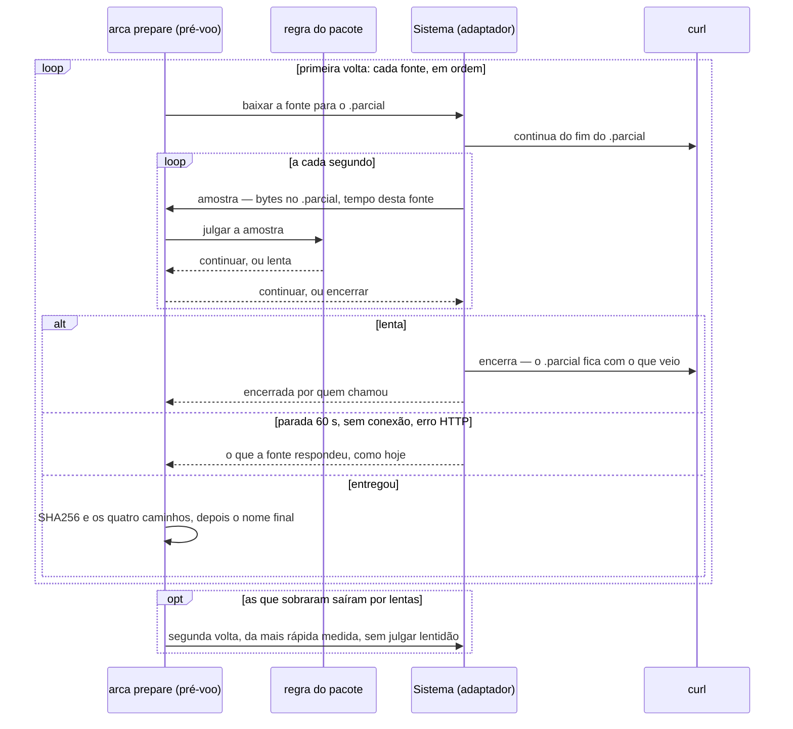

# Download do pacote

> Plan from this document. Each slice below carries its own shape - copy it, do not re-derive it.
> Status: confirmed by Eduardo, 23/10/2026 — fazer o download chegar ao fim e mostrar velocidade, quanto falta e uma barra; a versão do Clonezilla continua fixada. O usuário autorizou rever o ADR-0028.

## Situation

- Project: em uso. O 2.1.0, com o pacote guardado da WPC-134, está instalado desde 19/10/2026. Quem roda o `arca prepare` é um usuário só, em mais de um computador.
- Decision: aberta até 23/10/2026, quando o veredito foi confirmado. O pedido chegou como "atualizar o Clonezilla para a versão mais atual" e foi trocado por este, porque a versão não era a causa (Problem).
- In flight: nada aberto no Linear toca o download. Este desenho estende o do pacote guardado (`.design/pacote-guardado.md`): a lista de fontes, o `.parcial` único e os limites de 30 s e 60 s ficam como estão.
- At stake: baixo. Tudo acontece no pré-voo, antes do ponto sem volta, e o pior defeito possível é um preparo que demora ou recusa com o disco intacto. O SHA256 compilado continua sendo a última palavra. Só o contrato da porta (Key decision 4) custa mais do que um commit para desfazer.

## Problem

O `arca prepare` sem `--iso` não termina o download do Clonezilla em todo computador: "nunca funciona", nas palavras do usuário, sobre o preparo de 22/10/2026 num computador que não é esta mesa. A saída que sobra é baixar o zip pelo navegador e passá-lo com `--iso`, que é o que o próprio README recomenda quando nenhuma fonte entrega. Só que essa saída não fica: o `--iso` não alimenta o pacote guardado, e o preparo seguinte tenta baixar de novo. A cópia manual se repete a cada preparo. Enquanto o download corre, a tela diz quanto já veio e mais nada. Sem velocidade e sem quanto falta, a única decisão possível é esperar muito e cancelar.

A versão não é a causa, a fonte é. Em 23/10/2026, o navegador baixava o mesmo Clonezilla a 63,9 KB/s numa conexão de 800 Mb, com 2 horas restantes. No mesmo dia, desta mesa, o mirror do projeto entregou a `3.3.3-15` inteira a 5,1 MB/s, em 111 s, com o SHA256 compilado. O mesmo mirror do SourceForge serviu a `3.3.3-15` a 0,4 MB/s e a `3.3.3-37` a 1,2 MB/s, em amostras de 20 MB. E o `oldstable/` do mirror do projeto guarda todas as versões, desde a `1.0.7-18`.

O que não se mediu: o `arca.log` do computador em que o preparo falhou não está disponível. Não se sabe se o ARCA ficou numa fonte lenta até o cancelamento ou se largou as três. O 2.1.0 só larga uma fonte que fica 60 s sem mandar um byte, e a 64 KB/s ficaria nela mais de duas horas.

## Success

- Worked if: o próximo `arca prepare` sem `--iso` no computador em que falhou termina o download sozinho, sem cópia manual. E, se uma cópia manual ainda for preciso, ela acontece uma vez por computador, e não a cada preparo.
- Going wrong: a linha `Baixando Clonezilla` mostra mais de 10 minutos para terminar, por mais de 20 s, e a fonte não muda na primeira volta. Ou o mesmo computador volta a pedir o zip pelo navegador depois de um `--iso`.
- Review: no próximo `arca prepare` naquele computador — Eduardo.

## Boundary

In: o download do pré-voo do `arca prepare`, ou seja, como as fontes se revezam e o que a tela mostra enquanto ele corre. E o `--iso` alimentando o pacote guardado.

Out:
- Atualizar o Clonezilla sozinho, ou avisar que há versão nova: a versão não era a causa, porque os mesmos mirrors servem as duas, e PR-1 fica. Reabre se a `3.3.3-15` sumir do `oldstable/` do mirror do projeto e do SourceForge.
- Mais fontes, como mirrors do SourceForge escolhidos por nome: ganha se, com a regra nova, aquele computador ainda vir as três lentas.
- Baixar por várias conexões ao mesmo tempo, ou medir todas as fontes antes de escolher uma: ganha se uma fonte limitar a velocidade por conexão, e ninguém mediu isso.
- Lembrar, entre uma execução e outra, qual fonte foi a mais rápida: o `.parcial` já retoma, e a primeira volta custa no máximo cerca de um minuto.
- A barra do `curl`: continua calada, porque o andamento é do ARCA (ADR-0028).

Unchanged: PR-1 (`VERSAO`, `SHA256`, `TAMANHO_BYTES`), as três `FONTES` e a ordem delas, os 30 s de conexão e os 60 s de fonte parada, o `.parcial` único que se retoma, a conferência do passo 7, PR-3, o `--dry-run` que não baixa e B-10. Nenhum requisito novo: as duas mudanças moram dentro do que PR-7 e PR-2 já governam.

## Shape

O download do pré-voo passa a ser medido. A cada segundo, o adaptador entrega a uma regra pura quanto o `.parcial` tem e há quanto tempo a fonte corre, e dessa amostra saem a linha da tela e o julgamento de fonte lenta. Uma fonte lenta perde a vez na primeira volta, e na segunda a mais rápida medida vai até o fim; o `--iso` que passa no SHA256 passa a alimentar o pacote guardado. A porta é o contrato de `Sistema::baixar`, que passa a perguntar a quem chama se continua: todo adaptador e todo duplo o seguem, e desfazê-lo é refazer os dois.

Medir as fontes em paralelo antes de escolher, ou baixar por várias conexões, só ganha se uma fonte limitar a velocidade por conexão. Nada mediu isso, e a regra de duas voltas já cobre uma fonte lenta por inteiro.

## Key decisions

1. **Uma fonte lenta é julgada pelo que falta, e não por uma velocidade mínima.** Ela perde a vez quando, na velocidade dos últimos 20 s, o que falta do pacote levaria mais de 10 minutos, e nunca antes de 20 s de medição naquela fonte. Perto do fim, uma fonte lenta termina. No começo, a 64 KB/s, ela sai em 20 s. Os dois números moram com os 30 s e os 60 s de PR-7, ajustáveis. Isso revoga a parte da decisão 6 do ADR-0028 pela qual uma fonte lenta nunca é largada. Uma fonte que nada entregou nos últimos 20 s nunca terminaria, e por isso, na primeira volta, sai por lenta. A fonte parada, a de 60 s sem um byte, continua valendo na segunda volta.
2. **Nada é recusado por ser lento.** As fontes são tentadas em duas voltas. Na primeira, cada uma vai uma vez, em ordem, sujeita à decisão 1. Na segunda, voltam só as que saíram por lentas, da mais rápida medida para a mais lenta, sem a decisão 1. A primeira delas vai até o fim, e só a parada, a falta de conexão ou um erro HTTP a tiram. Toda troca continua do byte em que o `.parcial` está. Uma fonte que saiu por 404 ou sem conexão não volta.
3. **A tela mostra o mesmo número que decide.** A velocidade e o "faltam" da linha `Baixando Clonezilla` são a mesma medida dos últimos 20 s que julga a fonte lenta. Uma fonte nunca sai por lenta com a tela dizendo que falta pouco, e a linha que diz que ela saiu traz os dois números.
4. **Quem julga a lentidão é código puro, e o adaptador só mede e encerra.** O `andamento` de `Sistema::baixar` passa a receber, além do tamanho do `.parcial`, o tempo desde o começo daquela fonte, e a responder se o download continua. O adaptador encerra o `curl` quando a resposta é não. É o princípio do ADR-0028 (quem julga o que a fonte respondeu é código puro), e é o que deixa a regra ser testada com amostras inventadas, sem esperar 20 s. A parada de 60 s continua no adaptador, onde foi medida. O tempo é monotônico e medido pelo adaptador, nunca pelo `Relogio`: um ajuste de hora do Windows no meio do download faria a velocidade negativa. S-6 não é tocado, porque governa desfecho, e o download não julga desfecho.
5. **O `--iso` que passa no SHA256 alimenta o pacote guardado, por cópia, no pré-voo.** O arquivo de quem chamou fica onde está. A cópia passa pelo `.parcial`, é conferida e só então renomeada, e por isso o pacote guardado continua só existindo sob o nome final depois de passar no SHA256. A cópia de PR-3 vai direto para o nome final no `ARCAVAULT`: não copie esse precedente aqui. Isso revoga a linha de PR-2 do ADR-0028 ("ele também não alimenta o pacote guardado") e o conselho do README que dela decorre.
6. **Uma cópia que falha não recusa o preparo.** O preparo com `--iso` nunca dependeu do pacote guardado e continua saindo do arquivo do `--iso`. A cópia que não se faz, por falta de espaço, por permissão ou por haver uma pasta com o nome do pacote, vira uma linha de aviso na tela e no `arca.log`. Um pacote guardado que não se deixou medir não é tocado: não ter conseguido medir não é o mesmo que não bater.

## Work

| Slice | Delivers | Status |
|---|---|---|
| [Andamento](#andamento) | a linha `Baixando Clonezilla` com barra, porcentagem, quanto veio, velocidade e quanto falta, e uma linha `Fonte` por fonte tentada | open — 2 defaults taken |
| [Fontes do pacote](#fontes-do-pacote) | a fonte lenta perde a vez, e a mais rápida medida vai até o fim | clear |
| [`--iso`](#--iso) | o arquivo do `--iso` que passa no SHA256 vira o pacote guardado daquele computador | open — 1 default taken |
| [ADR-0029](#adr-0029) | a regra escrita: o ADR novo, PR-2 e PR-7 no PRD e no README, e o `CONTEXT.md` | clear |

Order: Andamento → Fontes do pacote → ADR-0029. O slice `--iso` não depende dos outros dois e pode correr em paralelo.

Already handled by existing code: Ctrl+C no meio do download → o `.parcial` fica com o que veio, e a próxima execução retoma (ADR-0028); fonte parada, sem conexão ou com erro HTTP → abandonada como hoje; `.parcial` que chega e não bate → zerado; `.parcial` do tamanho do pacote ou maior → recomeça do zero; `--dry-run` sem pacote guardado → não baixa.

Derivable from the repository, left to the plan: o texto da tela sem acento; as linhas no formato rótulo-pontilhado-valor na coluna 33; os tamanhos com vírgula decimal, e a velocidade nas mesmas unidades, por segundo; a linha por fonte tentada no `arca.log`. Tudo como o pré-voo de PR-7 já faz.

### Andamento

**Delivers** o que a tela mostra enquanto uma fonte corre. **Status: open.** Introduz o contrato da Key decision 4 e é o lado da tela da Key decision 3.

`Sistema::baixar(url, destino, limites, andamento)`: o `andamento` recebe o tamanho do `.parcial` e o tempo desde o começo da fonte, e responde *continuar* ou *encerrar*. O retorno é a `Transferencia`, que passa a dizer também se quem chamou a encerrou.

Os valores abaixo vêm depois de `Baixando Clonezilla .............`.

| State | What should happen | Caller sees |
|---|---|---|
| Uma fonte começa do zero | uma linha `Fonte` com a versão e o rótulo, e a linha viva começa abaixo dela | `Fonte ........................... 3.3.3-15 · free.nchc.org.tw (oldstable)` |
| Uma fonte retoma | a linha `Fonte` diz de onde | `Fonte ........................... 3.3.3-15 · free.nchc.org.tw (oldstable) · retomando de 120,0 MB` |
| Antes de haver o que medir | a barra no ponto em que o `.parcial` está, sem velocidade | `[████░░░░░░░░░░░░░░░░]  22% · 120,0 de 535,5 MB · medindo` |
| Baixando | barra de 20 casas, porcentagem, quanto veio, velocidade dos últimos 20 s e quanto falta | `[████░░░░░░░░░░░░░░░░]  20% · 110,0 de 535,5 MB · 5,0 MB/s · faltam 2 min` |
| Falta mais de uma hora | horas e minutos | `[░░░░░░░░░░░░░░░░░░░░]   2% · 16,0 de 535,5 MB · 64,0 KB/s · faltam 2 h 19 min` |
| O `.parcial` não cresce há 5 s ou mais | sem estimativa; diz há quanto tempo, porque a fonte vai sair | `[░░░░░░░░░░░░░░░░░░░░]   1% · 10,0 de 535,5 MB · 0 B/s · parada ha 5 s` |
| A fonte entregou | a linha fica em 100% e termina | `[████████████████████] 100% · 535,5 de 535,5 MB · 5,0 MB/s` |

A linha inteira cabe em 120 colunas com qualquer valor, que é o que a deixa ser reescrita no lugar. Por isso a versão e o rótulo da fonte saem dela e vão para a linha `Fonte`, e quanto veio é dito na unidade do total. A barra e a porcentagem arredondam para baixo, para 100% só aparecer com o pacote inteiro; quanto falta arredonda para cima, para a tela nunca mostrar 10 minutos ou menos numa fonte que sai por lenta.

1. A versão e o rótulo numa linha `Fonte` própria, e não na linha viva — default. Com eles dentro, como a linha foi mostrada ao usuário em 23/10/2026, ela passaria de 120 colunas.
2. A barra com `█` e `░` — default. Falta medir que o console os desenha, como `examples/ponto_no_console.rs` mediu o `·`. Se não desenhar, a barra fica com `#` e `-`.

### Fontes do pacote

**Delivers** o revezamento das fontes em duas voltas. **Status: clear.** Key decisions 1 e 2.

| State | What should happen | Caller sees |
|---|---|---|
| Fonte que termina em até 10 minutos | vai até o fim | a linha viva até 100% |
| Fonte lenta na primeira volta | sai depois de ao menos 20 s; o `.parcial` fica com o que veio, e a próxima continua dali | `Fonte abandonada ................ free.nchc.org.tw (oldstable) · lenta: faltariam 2 h 23 min a 64,0 KB/s` |
| Fonte que nada entregou nos últimos 20 s, na primeira volta | sai por lenta (Key decision 1) | `Fonte abandonada ................ free.nchc.org.tw (oldstable) · lenta: nada veio nos ultimos 20 s` |
| Fonte lenta na primeira volta, com o `.parcial` parado há 5 s ou mais | sai por lenta e volta na segunda como 0 B/s (emendado em 23/10/2026, na revisão do PR 1) | `Fonte abandonada ................ free.nchc.org.tw (oldstable) · lenta: parada ha 19 s` |
| Todas as que sobraram saíram por lentas | segunda volta: a mais rápida medida volta e vai até o fim | `Fonte ........................... 3.3.3-15 · downloads.sourceforge.net · segunda volta · retomando de 31,2 MB` |
| A da segunda volta para, perde a conexão ou dá erro HTTP | sai, e entra a seguinte mais rápida da segunda volta | a linha `Fonte abandonada` de hoje |
| 404, sem conexão ou erro HTTP na primeira volta | sai como hoje e não entra na segunda | a linha `Fonte abandonada` de hoje |
| Nenhuma fonte entregou | a recusa de hoje no pré-voo, `Nada foi apagado (PR-7)`, com o que cada fonte respondeu por último | o texto de hoje |

Alternatives considered: uma velocidade mínima no lugar do "quanto falta" — ganha se o pacote passar a ter tamanhos muito diferentes entre versões, e hoje é um só, de 535,5 MB.

### `--iso`

**Delivers** o arquivo do `--iso` que passa no SHA256 virando o pacote guardado daquele computador, no pré-voo. **Status: open.** Key decisions 5 e 6.

| State | What should happen | Caller sees |
|---|---|---|
| `--iso` bate, nada guardado | copiado para o `.parcial`, conferido e renomeado para o pacote guardado; o preparo segue do arquivo do `--iso` | `Pacote guardado .. copiado do --iso para C:\Users\…\ARCA\clonezilla-live-3.3.3-15-amd64.zip · o proximo preparo nao baixa (PR-2)` |
| `--iso` bate, e o guardado também | nada é escrito | nenhuma linha nova |
| `--iso` bate, e o guardado não | o guardado é substituído pela cópia, porque o que não bate não é o pacote | `Pacote guardado .. nao batia com o SHA256 deste ARCA · substituido pela copia do --iso` |
| O guardado não se deixa medir | não é tocado | `Pacote guardado .. nao deu para medir o que ja esta guardado (<motivo>) · deixado como esta` |
| A cópia não se faz | aviso, e o preparo segue do `--iso` | `Pacote guardado .. nao deu para guardar em <pasta> (<motivo>) · este preparo segue do --iso` |
| A cópia não bate depois de copiada | o `.parcial` é zerado, aviso, e o preparo segue do `--iso` | `Pacote guardado .. a copia nao bateu com o SHA256 · este preparo segue do --iso` |
| `--iso` recusado (não está lá, é uma pasta, não bate, está incompleto) | a recusa de hoje; nada é copiado | o texto de hoje |
| `--dry-run` com `--iso` | nada é escrito | `Pacote guardado .. o preparo de verdade copia o --iso para este PC; o ensaio nao escreve` |

Alternatives considered: mover o arquivo do `--iso` em vez de copiá-lo — ganha se o computador não comportar duas cópias de 535,5 MB, e o arquivo é de quem chamou. Usar a cópia recém-guardada nos passos 6 e 7, no lugar do arquivo do `--iso` — ganha se o `--iso` costumar vir de um lugar que some no meio do preparo; o passo 7 já o confere de novo e recusa.

1. O guardado que já bate não ganha linha na tela — default. Quando nada muda, a tela do `--iso` é a de antes.

### ADR-0029

**Delivers** a regra escrita. **Status: clear.**

| Documento | O que passa a dizer |
|---|---|
| ADR-0029, novo | as Key decisions 1 a 6, as medições de 23/10/2026 do Problem e o que fica do ADR-0028 |
| ADR-0028 | a decisão 6 e a linha de PR-2 em "O que fica como estava" passam a apontar para o ADR-0029, que as revê; o resto fica |
| PRD, PR-7 e PR-2, e a tabela do README que os repete | PR-7 ganha a fonte lenta e o andamento com velocidade e quanto falta. PR-2 passa a dizer que o `--iso` que passa no SHA256 alimenta o pacote guardado |
| README, a saída para quando nenhuma fonte entrega | baixar pelo navegador e passar com `--iso` continua sendo a saída, e agora a cópia fica guardada |
| `CONTEXT.md`, **Pacote guardado** | o `--iso` que passa no SHA256 também o alimenta |

## Migration

O `.parcial` e o pacote guardado do 2.1.0 continuam valendo, com o mesmo nome e a mesma retomada. Um computador só ganha a mudança quando recebe o `arca.exe` novo, e a cópia do `arca.exe` que está no OneDrive é de 04/10/2026.

## Sources

- `docs/adr/0028-nenhum-download-depois-do-ponto-sem-volta.md` — a decisão 6 e a linha de PR-2 que este desenho revê, e as medições do `curl` que continuam valendo.
- `.design/pacote-guardado.md` — o desenho que este estende; a velocidade dos servidores estava no Out dele.
- `PRD/PRD-ARCA-v5_1.md` §9.6 — PR-1, PR-2 e PR-7.
- `https://free.nchc.org.tw/clonezilla-live/` (`stable/`, `stable/CHECKSUMS.TXT` e `oldstable/`) e `https://sourceforge.net/projects/clonezilla/files/clonezilla_live_stable/`, lidos e medidos em 23/10/2026 — a `3.3.3-15` está nas duas fontes, e a estável corrente é a `3.3.3-37`.
