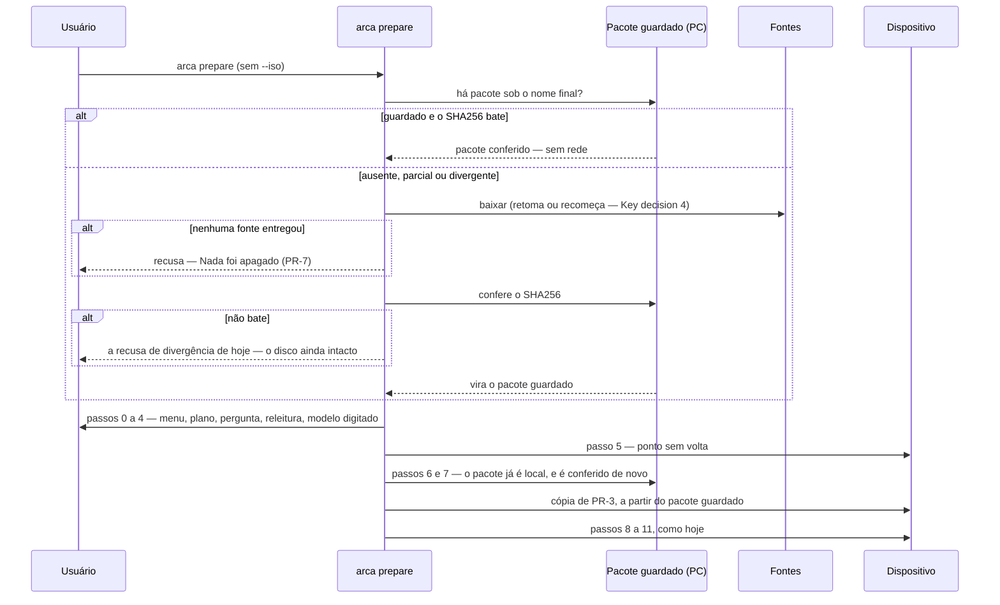

# Pacote guardado

> Plan from this document. Each slice below carries its own shape - copy it, do not re-derive it.
> Status: confirmed by Eduardo, 04/10/2026 — consertar o download; a versão do Clonezilla continua fixada e é atualizada à mão, sob pedido.

## Situation

- Project: em uso. A 2.0.0 é o primeiro release, e quem roda o `arca prepare` é um usuário só, nesta mesa — às vezes duas vezes no mesmo dia, às vezes uma vez por mês.
- Decision: aberta até 04/10/2026, quando o veredito foi confirmado.
- In flight: nada no Linear toca o pacote nem o download. O precedente copiado é o pré-voo do `--iso` (WPC-64, WPC-66, WPC-68), que já recusa com "nada foi apagado"; a troca da versão do Clonezilla fica fora (ver Boundary).
- At stake: médio. O `arca prepare` é a operação que apaga disco, mas a mudança volta com um commit, e o pior defeito possível aqui é um preparo que recusa: o SHA256 compilado continua sendo a última palavra sobre o que se instala.

## Problem

Em 03/10/2026, o dia inteiro, e na manhã de 04/10/2026, o `arca prepare` ficou parado no download do Clonezilla sem dizer nada, até o usuário cancelar — e não foi a primeira vez. Cada tentativa custa o disco antes de falhar: o passo 5 apaga o dispositivo e só o passo 6 baixa. E cada preparo baixa 535,5 MB de novo, porque o mesmo passo 5 apaga a cópia de PR-3 que estava no `ARCAVAULT`.

O download não tem limite para uma transferência parada e roda sem andamento na tela; a FAQ do `curl` diz que, sem um limite próprio, uma conexão que morre não é detectada. O travamento não foi reproduzido em 04/10/2026 — o link fixado respondeu. Medido nesse dia, 20 MB de cada fonte: SourceForge a 0,9 MB/s, mirror do projeto a 1,5 MB/s, ou seja, de 6 a 10 minutos por download quando ele funciona (estimativa de uma amostra).

A versão fixada não é a causa. A `3.3.3-15` está no mirror do projeto em `oldstable/3.3.3-15/`, com o mesmo SHA256 e o mesmo tamanho, e a versão mais nova é servida pelo mesmo SourceForge.

## Success

- Worked if: nenhum `arca prepare` fica parado sem dizer nada, nenhum termina com o disco apagado por causa do download, e o segundo preparo da mesma versão não usa a rede.
- Going wrong: a tela fica mais de 60 s sem mudar durante um download, ou o pré-voo baixa de novo um pacote que já estava guardado.
- Review: depois dos cinco primeiros preparos com a mudança — Eduardo.

## Boundary

In: o `arca prepare` sem `--iso` — de onde vem o pacote, quando ele vem e o que a tela mostra no caminho.

Out:
- Usar automaticamente a versão mais nova do Clonezilla — instalaria um Clonezilla que nunca rodou as receitas do ARCA e revogaria PR-1. Atualizar continua sendo tarefa sob pedido: versão e SHA256 de duas fontes, `grub.cfg` recapturado e um ciclo de backup, verificação e restauração em hardware, como o ADR-0018 descreve. Reabre se o Clonezilla passar a publicar correções de que o ARCA precise mais depressa do que esse ciclo consegue acompanhar.
- Avisar que existe versão nova — o usuário pede quando quiser.
- Limpar pacotes guardados de versões antigas — B-10; quem apaga é uma pessoa, olhando.
- A velocidade dos servidores — o primeiro download de cada versão continua levando minutos.

Unchanged: PR-1 (versão `3.3.3-15`, SHA256 compilado), PR-2 (o `--iso` não consulta nem escreve o pacote guardado), PR-3 (a cópia no `ARCAVAULT`, depois do passo 5), a conferência do passo 7, PR-4 e as sete defesas de PR-5.

## Shape

O pacote guardado é uma cópia do zip do Clonezilla no PC, nomeada pela versão, que só existe sob esse nome depois de passar no SHA256 compilado. O `arca prepare` sem `--iso` passa a obtê-lo no pré-voo — reusando o guardado ou baixando de uma lista de fontes que não trava calada — e dali em diante segue o caminho que o `--iso` já segue. A porta é a ordem: tirar o download de depois do ponto sem volta vira PR-7 e muda um teste que hoje exige o contrário, e desfazê-la seria voltar a apagar o disco antes de saber se há pacote.

Um comando `arca baixar` separado, que gerenciasse pacotes de várias versões, só ganha se houver mais de uma versão do Clonezilla em uso ao mesmo tempo — e a versão continua uma só.

## Key decisions

1. **Nenhum download acontece depois do ponto sem volta.** Sem `--iso`, o pacote é obtido e conferido no pré-voo, antes do passo 0, e o resto do comando é o caminho do `--iso`. Entra como PR-7 no PRD, com o ADR-0028. O teste do pré-voo sem `--iso` (WPC-66) hoje exige que o pacote seja conferido "uma vez só, depois do ponto sem volta": ele muda por decisão, e não para ficar verde — é a premissa dele que esta decisão revoga.
2. **O pacote guardado mora no PC, em `%LOCALAPPDATA%\ARCA\`, onde o registro já mora, nomeado pela versão.** Fora do dispositivo de propósito: o passo 5 apaga o dispositivo. Uma restauração do `C:` que o leve embora custa um download, e nada mais.
3. **Guardado não é confiado.** O SHA256 compilado é conferido a cada uso — no pré-voo e de novo no passo 7, como o `--iso` já é. Nenhuma fonte é confiável, e por isso elas são intercambiáveis: PR-1 não muda.
4. **Um pacote só existe sob o nome final depois de passar no SHA256.** O download em andamento mora sob outro nome, e é ele que se retoma. O tamanho compilado decide entre retomar e recomeçar: menor que ele, retoma; do tamanho ou maior, recomeça do zero.
5. **O ARCA nunca apaga um pacote guardado (B-10)**, nem o de uma versão antiga. O único arquivo que se substitui é o que não passou no SHA256, porque um arquivo que não bate não é o pacote — é a mesma exceção que a escrita atômica já tem.
6. **Nenhum download fica mudo.** Uma fonte que não conecta em 30 s, ou que fica 60 s sem entregar nada, é abandonada, e a próxima continua do byte em que a anterior parou. A tela mostra quanto já veio.
7. **O `--dry-run` não baixa.** Ele diz se o pacote já está guardado e conferido, ou que o preparo de verdade vai baixá-lo antes de qualquer pergunta.

## Work

| Slice | Delivers | Status |
|---|---|---|
| [Pacote guardado](#pacote-guardado-1) | o `arca prepare` sem `--iso` obtém o pacote no pré-voo, reusa o guardado e nunca baixa depois do passo 5 | open — 1 default taken |
| [Fontes do pacote](#fontes-do-pacote) | o download mostra andamento, abandona fonte parada, troca de fonte e retoma de onde parou | open — 2 defaults taken |

Order: Pacote guardado → Fontes do pacote. O primeiro já torna o travamento inofensivo para o disco; o segundo o torna visível e curto.

Already handled by existing code: `--iso` → o pré-voo de PR-2, intacto; um pacote divergente depois de baixado → `RecusaDoPacote` de divergência, que já diz que o número esperado não veio junto do download; nenhum disco conectado → o menu do passo 0, depois de o pacote já ter ficado guardado.

Derivable from the repository, left to the plan: o texto da tela em ASCII sem acento, as linhas no formato rótulo-pontilhado-valor do plano, as recusas de pré-voo terminando em "Nada foi apagado (PR-x)" — tudo como `RecusaDoPacote` e o pré-voo do `--iso` já fazem. O termo **pacote guardado** entra no `CONTEXT.md`, distinto da cópia de PR-3, que mora no dispositivo.

### Pacote guardado

**Delivers** o pré-voo do `arca prepare` sem `--iso`, que obtém e confere o pacote antes do passo 0. **Status: open.** É a porta: Key decisions 1, 2, 3, 5 e 7.

| State | What should happen | Caller sees |
|---|---|---|
| Sem `--iso`, nada guardado | baixa para o pacote guardado (Fontes do pacote), confere, segue para o passo 0 | `Baixando Clonezilla` com versão e tamanho e "nada tocado ainda"; depois `Pacote conferido` com o resumo abreviado e o caminho guardado |
| Sem `--iso`, guardado e o SHA256 bate | não usa a rede | só `Pacote conferido`, dizendo que estava guardado neste PC |
| Guardado e o SHA256 não bate | baixa de novo, do zero, e substitui (Key decision 5) | uma linha dizendo que o guardado não bate e vai ser baixado de novo |
| Download em andamento de uma execução anterior | retoma (Key decision 4) | `Baixando Clonezilla`, dizendo de quanto retoma |
| Nenhuma fonte entregou o pacote | recusa no pré-voo, nada tocado; o download parcial fica para a próxima vez | cada fonte e o que ela respondeu, "Nada foi apagado (PR-7)" e o caminho manual: o link do mirror do projeto e o `--iso` |
| A pasta do pacote guardado não aceita escrita, ou o `C:` está cheio | recusa no pré-voo, nada tocado | o que o Windows respondeu, e "Nada foi apagado (PR-7)" |
| Ctrl+C durante o download | o processo termina antes do passo 0 | nada novo; a próxima execução retoma |
| `--dry-run`, nada guardado | não baixa | uma linha dizendo que o preparo de verdade baixa 535,5 MB antes de qualquer pergunta, e que o ensaio não baixa |
| `--dry-run`, guardado | confere o SHA256, que é leitura | `Pacote conferido`, como no preparo de verdade |
| Plano (PR-4), sem `--iso` | o Clonezilla aparece como vindo do pacote guardado, já conferido | a linha do Clonezilla em "E O QUE MAIS VAI ACONTECER" deixa de prometer download |
| Plano (PR-4), `--dry-run` sem pacote guardado | o Clonezilla aparece como o que o preparo de verdade vai baixar antes do menu e guardar neste PC | a linha do Clonezilla diz isso, com o tamanho |
| Passos 6 e 7 | o passo 7 confere de novo, e a cópia de PR-3 sai do pacote guardado depois disso | como hoje com o `--iso` |

Alternatives considered: baixar depois da confirmação digitada, e não antes do menu — ganha se a espera do primeiro preparo de cada versão incomodar mais do que a releitura do disco de PR-4 ficar 10 minutos velha, e hoje não incomoda.

1. O texto da recusa "nenhuma fonte entregou" — default: as linhas acima; o texto literal é aprovado no plano e registrado no issue.

### Fontes do pacote

**Delivers** a lista de fontes do pacote, compilada por versão, e um download que nunca fica mudo. **Status: open.** Key decision 6.

| State | What should happen | Caller sees |
|---|---|---|
| Uma fonte entrega normalmente | o download corre até o fim | quanto já veio, de 535,5 MB, atualizado enquanto vem |
| Uma fonte não conecta em 30 s | é abandonada, a próxima é tentada | uma linha com a fonte e "nao respondeu" |
| Uma fonte fica 60 s sem entregar nada | é abandonada, e a próxima continua do byte em que esta parou | uma linha com a fonte, "parou de mandar" e quanto já tinha vindo |
| Uma fonte responde erro HTTP (por exemplo, o arquivo mudou de pasta no mirror) | é abandonada, a próxima é tentada | uma linha com a fonte e o código |
| Todas as fontes falharam | o pré-voo recusa (Pacote guardado) | ver Pacote guardado |

As fontes, em ordem: o mirror do projeto em `oldstable/<versão>/`, o mesmo mirror em `stable/` e o SourceForge em `clonezilla_live_stable/<versão>/`. O mirror move a versão de `stable/` para `oldstable/` quando sai a seguinte — a `3.3.3-15` já está em `oldstable/` —, e por isso ele entra com as duas pastas; um 404 custa um segundo. Cada fonte leva a versão no nome do arquivo, como a URL de hoje leva.

Alternatives considered: o SourceForge primeiro — ganha se o mirror do projeto se mostrar mais lento ou mais instável do que ele nos primeiros preparos; a única medição (04/10/2026) deu o mirror cerca de 1,7 vez mais rápido, e foi o SourceForge que travou.

1. 30 s para conectar e 60 s sem dados — default; ajustáveis se um mirror lento os disparar sem estar parado.
2. Ordem das fontes — default: o mirror do projeto primeiro, pelas razões acima.

## Migration

Nenhuma. O primeiro `arca prepare` depois da mudança baixa uma vez para o pacote guardado; os dispositivos já preparados e as cópias de PR-3 que eles carregam não mudam.

## Sources

- `PRD/PRD-ARCA-v5_1.md` §9.6 — PR-1 a PR-6, o que fica como está, e onde PR-7 entra.
- `docs/adr/0018-o-pacote-e-o-zip-e-o-prepare-desarma-o-que-instala.md` — por que a versão é fixada, e o que trocá-la exige.
- Documentação do `curl` (`--speed-limit`, `--speed-time`, `--connect-timeout`, `-C -` e a FAQ sobre cabo desconectado), consultada em 04/10/2026 — o `curl` do `System32` (8.21.0) já faz o que a Key decision 6 pede, sem dependência nova.
- `https://free.nchc.org.tw/clonezilla-live/` (`stable/` e `oldstable/3.3.3-15/`) e `https://sourceforge.net/projects/clonezilla/files/clonezilla_live_stable/`, lidos em 04/10/2026 — onde a `3.3.3-15` ainda está, com o mesmo SHA256 e o mesmo tamanho.
